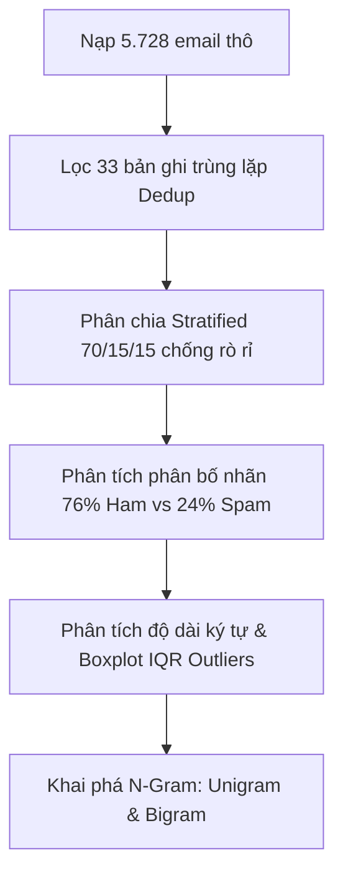
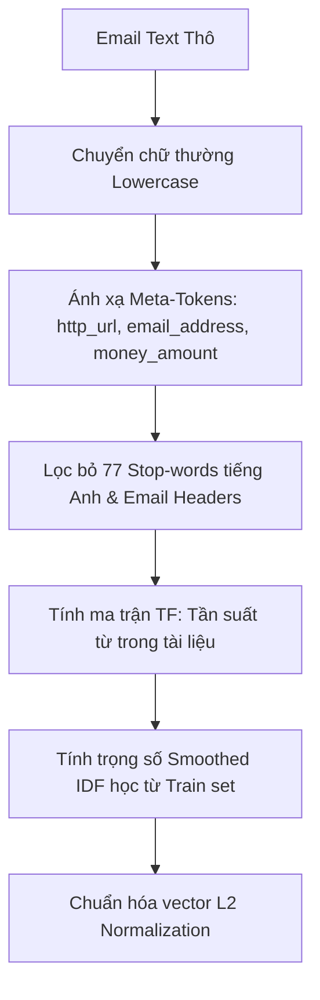
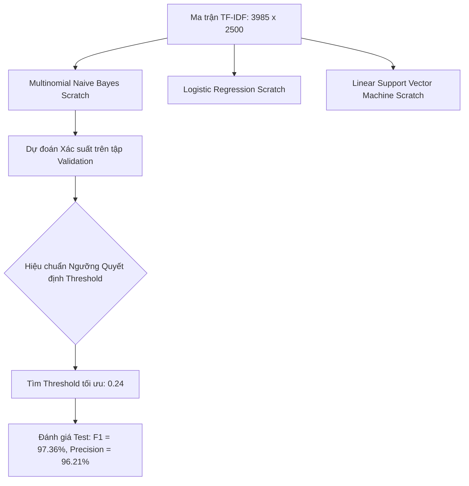

# LAB 1: PHÂN LOẠI EMAIL SPAM 
---

## 1. TỔNG QUAN OUTPUT (KẾT QUẢ ĐẦU RA)

### Output của bài toán này là gì?
- **Định dạng:** Output cuối cùng gồm 3 thành phần:
  1. Nhãn phân loại nhị phân: `🚨 SPAM (THƯ RÁC)` (nhãn 1) hoặc `✅ HAM (THƯ HỢP LỆ)` (nhãn 0).
  2. Xác suất phần trăm: Ví dụ `Xác suất Spam: 98.35%`.
  3. **Khả năng giải thích (Explainable AI):** Top 5 từ khóa kích hoạt mạnh nhất dẫn tới quyết định (*Top 5 Trigger Words*).
- **Lưu trữ ở đâu?**
  - Dữ liệu sạch sau tiền xử lý: `data/processed/train_cleaned.csv`, `test.csv`, `validation.csv`
  - Ma trận đặc trưng số hóa: `data/processed/tfidf_splits.npz`
  - Trọng số mô hình và từ điển xuất xưởng: `models/email_classifier.json`
  - Báo cáo kết quả kiểm thử: `reports/evaluation_results.md` và `reports/demo_results.md`

---

## 2. QUY TRÌNH PHÂN TÍCH KHÁM PHÁ (EDA)

### Chi tiết các bước và Giải thích Code
- **Tại sao phải Dedup (xóa trùng lặp) trước khi chia tập?**
  Trong tập dữ liệu thực tế có 33 email bị gửi lặp lại nhiều lần. Nếu không xóa, cùng một nội dung email có thể vừa rơi vào tập Train vừa lọt vào tập Test, khiến mô hình chỉ cần "học thuộc lòng" là đoán đúng 100%, gây ra ảo tưởng về độ chính xác (**Data Leakage**).
- **Phân chia Stratified (Phân tầng):** Tỷ lệ nhãn trong dữ liệu là ~76% Ham và ~24% Spam (mất cân bằng 3.19 : 1). Nếu chia ngẫu nhiên thông thường, tập Test có thể bị thiếu mẫu Spam. Phân chia Stratified đảm bảo tỷ lệ 76/24 được bảo toàn chuẩn xác trên cả 3 tập (Train: 3985 mẫu, Val: 854 mẫu, Test: 856 mẫu).

### Phân tích biểu đồ và Con số cụ thể
1. **Phân bố độ dài email (Boxplot & Histogram):**
   - Email Ham (hợp lệ) có độ dài trung bình lớn hơn (~1.555 ký tự) do chứa các văn bản báo cáo công việc nội bộ.
   - Email Spam có độ dài phân tán cực kỳ dị thường: xuất hiện các email cực ngắn (chỉ 1 dòng link lừa đảo) hoặc cực dài (do kỹ thuật nhồi từ khóa *word-salad* để đánh lừa bộ lọc).
2. **Khai phá Bigram (Cụm 2 từ):**
   - Top Bigram của Ham: *"enron enron"*, *"hou ect"*, *"vince kaminski"* (ngữ cảnh công việc nội bộ tập đoàn năng lượng Enron).
   - Top Bigram của Spam: *"click here"*, *"http www"*, *"free shipping"*, *"money back"*, *"please contact"* (cụm từ giật gân, kêu gọi hành động).

---

## 3. QUY TRÌNH TIỀN XỬ LÝ & BỘ TRÍCH XUẤT ĐẶC TRƯNG TF-IDF SCRATCH

### Chi tiết các bước và Giải thích Code
- **Tại sao lại dùng kỹ thuật Meta-Token Mapping thay vì xóa URL, Email, Dấu $?**
  Hầu hết các hướng dẫn NLP cơ bản đều xóa sạch ký tự đặc biệt và link. Tuy nhiên, trong bài toán Spam, **sự xuất hiện của một đường link (`http://...`) hoặc một số tiền lớn (`$1,000,000`) là tín hiệu lừa đảo mạnh nhất!** Nếu xóa đi, mô hình sẽ mất trắng manh mối. Vì vậy, ta chuyển đổi:
  - `https://scam-site.com/login` $\rightarrow$ `http_url`
  - `support@bank.com` $\rightarrow$ `email_address`
  - `$500,000` $\rightarrow$ `money_amount`
- **Bộ trích xuất TF-IDF tự lập trình 100% bằng NumPy:**
  1. **TF (Term Frequency):** $\text{TF}(t, d) = \frac{\text{count}(t, d)}{\sum_{t'} \text{count}(t', d)}$ đo mức độ xuất hiện của từ trong email.
  2. **Smoothed IDF (Inverse Document Frequency):** $\text{IDF}(t) = \ln\left(\frac{1 + N_{\text{train}}}{1 + \text{DF}(t)}\right) + 1.0$. Từ nào xuất hiện ở khắp mọi email thì IDF tiến về gần 1 (ít giá trị phân loại), từ nào chỉ xuất hiện ở một số email đặc biệt thì IDF rất cao.
  3. **L2 Normalization:** Chia vector cho độ dài Euclid của nó để triệt tiêu ảnh hưởng của độ dài văn bản (email 100 từ và email 1000 từ có cùng tỷ lệ từ khóa sẽ có vector tương đương nhau).

---

## 4. QUY TRÌNH HUẤN LUYỆN 3 MÔ HÌNH FROM-SCRATCH & HIỆU CHUẨN NGƯỠNG

### Giải nghĩa Thuật toán và Code
1. **Multinomial Naive Bayes (MNB):**
   - Mô hình xác suất sinh mẫu (Generative model) dựa trên định lý Bayes.
   - Sử dụng kỹ thuật làm mịn Laplace smoothing ($\alpha = 0.1$) để tránh trường hợp một từ mới chưa gặp bị nhân xác suất bằng 0.
   - Tính toán hoàn toàn trên không gian logarit (`np.log`) để tránh hiện tượng tràn số dưới (Arithmetic Underflow) khi nhân hàng nghìn số thập phân cực nhỏ.
2. **Tại sao phải Hiệu chuẩn Ngưỡng (Threshold Calibration)?**
   - Mặc định, các mô hình học máy gán nhãn Spam nếu xác suất $P \ge 0.50$.
   - Tuy nhiên, trong lọc thư rác, nếu ngưỡng quá cao (0.50), nhiều thư rác tinh vi có xác suất $0.3 \sim 0.4$ sẽ bị lọt vào Inbox.
   - Quá trình quét ngưỡng trên tập Validation tìm được **ngưỡng tối ưu là 0.24**, giúp điểm F1 tăng vọt từ $95.76\%$ lên **$97.36\%$**, bắt trọn $98.54\%$ số lượng thư rác mà không làm tăng đáng kể báo động giả.

---

## 5. ĐÁNH GIÁ MÔ HÌNH VÀ CÁC CÂU HỎI VẤN ĐÁP THƯỜNG GẶP (VIVA FAQS)

### Bảng so sánh 3 mô hình trên Test Set (Threshold = 0.24)
| Mô hình | Accuracy | Precision | Recall | F1-Score | ROC-AUC |
| :--- | :---: | :---: | :---: | :---: | :---: |
| **Multinomial Naive Bayes (Quán quân)** | **0.9872** | **0.9621** | **0.9854** | **0.9736** | **0.9993** |
| Logistic Regression | 0.9428 | 0.8078 | 1.0000 | 0.8937 | 0.9978 |
| Linear SVM | 0.8353 | 0.5937 | 1.0000 | 0.7450 | 0.9996 |

