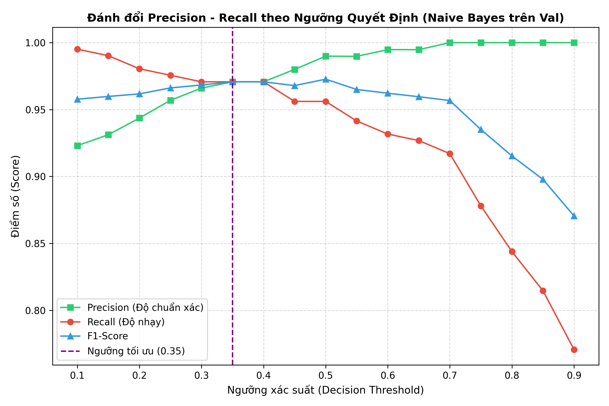

# BÁO CÁO THÍ NGHIỆM MÔN MÁY HỌC (MACHINE LEARNING)
**Tập dữ liệu:** `data/raw/emails.csv` (Kaggle Dataset)
## 1.1. GIỚI THIỆU (INTRODUCTION)
### 1.1.1. Định nghĩa bài toán (Problem Definition)
Phân loại thư rác (Email Spam Classification) là một trong những bài toán kinh điển và quan trọng nhất trong học máy ứng dụng vào an ninh mạng. Hàng ngày, người dùng phải đối mặt với hàng tỷ email chứa mã độc, lừa đảo tài chính (phishing), hoặc quảng cáo làm phiền.
Mục tiêu cốt lõi của bài thực hành: **Xây dựng mô hình học máy tự động phân loại nội dung văn bản email thành một trong hai lớp: "Spam" (thư rác/nguy hiểm) hoặc "Ham" (thư hợp lệ/an toàn).**
### 1.1.2. Bối cảnh ứng dụng và nghiên cứu (Business or Research Context)
Bộ lọc thư rác mạnh mẽ là tính năng nền tảng của mọi nhà cung cấp dịch vụ email (Gmail, Outlook). Mô hình lọc thư rác hiệu quả giúp:
- Bảo vệ người dùng khỏi các nguy cơ lừa đảo và phần mềm gián điệp.
- Giảm thiểu lãng phí thời gian và tăng năng suất lao động.
- **Ràng buộc an toàn:** Chi phí của việc đánh dấu nhầm thư hợp lệ thành thư rác (*False Positive*) lớn hơn rất nhiều so với việc để lọt một vài thư rác (*False Negative*). Do đó, chỉ số **Precision** đối với lớp Spam phải được tối ưu ở mức cực cao, đồng thời kiểm soát nghiêm ngặt tỷ lệ đánh nhầm (*False Positive Rate*).
### 1.1.3. Mục tiêu bài thực hành (Objectives of the Lab)
1. Thực hiện làm sạch và tiền xử lý dữ liệu văn bản thô, ánh xạ các thẻ siêu từ (*meta-tokens*).
2. Tự lập trình bộ trích xuất đặc trưng **TF-IDF Vectorizer từ đầu bằng NumPy thuần** (*Custom TF-IDF Vectorizer from Scratch*).
3. Tự lập trình **3 thuật toán học máy từ đầu** không dùng thư viện:
   - **Multinomial Naive Bayes** (Học xác suất sinh mẫu - *Generative Probabilistic Learning*).
   - **Logistic Regression** (Học xác suất phân biệt tuyến tính - *Discriminative Linear Learning*).
   - **Linear Support Vector Machine - SVM** (Phân tách hình học lề cực đại - *Maximum-Margin Geometric Separation*).
4. Thực hiện hiệu chuẩn ngưỡng quyết định (*Decision Threshold Calibration*) để đạt điểm F1 tối ưu.
5. Đóng gói mô hình dưới dạng **JSON Artifact** (`models/email_classifier.json`) và xây dựng mô-đun suy diễn thời gian thực tích hợp **Khả năng giải thích Explainable AI (Top 5 Trigger Words)**.
6. **Áp dụng mô hình huấn luyện vào bộ lọc email:** Đánh giá toàn diện các chỉ tiêu hiệu năng (Accuracy, Precision, Recall, F1-Score, ROC-AUC) và phân tích định lượng tỷ lệ đánh nhầm (False Positive Rate, False Negative Rate).
### 1.1.4. Loại bài toán học máy (Machine Learning Task Type)
Bài toán thuộc lớp **Học có giám sát (Supervised Learning)**, cụ thể là **Phân loại văn bản nhị phân (Binary Text Classification)**:
- $y = 0$: Ham (Thư hợp lệ / an toàn).
- $y = 1$: Spam (Thư rác / lừa đảo).
## 1.2. MÔ TẢ TẬP DỮ LIỆU & QUY TRÌNH DỰ ÁN (DATASET & WORKFLOW)
### 1.2.1. Nguồn dữ liệu
Tập dữ liệu sử dụng là **Spam Email Dataset** từ nguồn Kaggle:
`https://www.kaggle.com/datasets/jackksoncsie/spam-email-dataset`

### 1.2.2. Cấu trúc tập dữ liệu
Tập dữ liệu gốc gồm **5,728 dòng** và **2 cột**. Sau khi loại 33 email trùng nội dung, pipeline sử dụng **5,695 mẫu**:
- `text`: Nội dung email (chuỗi ký tự bắt đầu bằng tiền tố `Subject:`).
- `spam`: Nhãn nhị phân (`0` là Ham, `1` là Spam).

### 1.2.3. Quy trình thực hiện (Pipeline Overview: Training Phase & Inference Phase)
Quy trình xây dựng và áp dụng mô hình phân loại email được thiết kế theo 2 luồng độc lập, khép kín: **Luồng huấn luyện (Training Phase)** và **Luồng suy diễn / Giao diện áp dụng bộ lọc email (Inference / Interface Phase)**.

#### 1. Luồng huấn luyện mô hình (Training Phase)
Sử dụng dữ liệu lịch sử đã gán nhãn để học tri thức, trích xuất đặc trưng và tối ưu hóa tham số mô hình:
- **Dữ liệu huấn luyện (Training Data):** Bắt đầu từ tập dữ liệu thô `data/raw/emails.csv` (5,728 email), loại bỏ 33 email trùng lặp và phân chia phân tầng (Stratified Split 70/15/15) thành 3 tập riêng biệt: Train (3,985 mẫu), Validation (854 mẫu), Test (856 mẫu).
- **Tiền xử lý & Trích xuất đặc trưng TF-IDF:** Chuẩn hóa text và ánh xạ thẻ siêu từ (*meta-tokens*). Bộ trích xuất `TfidfVectorizerScratch` được **fit duy nhất trên tập Train** để học bộ từ điển 2,500 từ vựng và vector trọng số IDF. Sau đó, dùng tham số này transform cho Train, Validation và Test nhằm ngăn chặn rò rỉ dữ liệu (*Data Leakage*).
- **Huấn luyện mô hình From-Scratch:** Huấn luyện 3 mô hình học máy (Multinomial Naive Bayes, Logistic Regression, Linear SVM) hoàn toàn bằng NumPy thuần trên ma trận đặc trưng $X_{\text{train}}$.
- **Hiệu chuẩn ngưỡng quyết định (Threshold Calibration):** Đánh giá các mô hình trên tập Validation $X_{\text{val}}$, quét tìm ngưỡng xác suất tối ưu ($\text{BEST\_THRESHOLD} = 0.24$) nhằm cân bằng giữa việc nâng cao Recall và duy trì Precision cao.
- **Đánh giá kiểm thử (Held-Out Test Evaluation):** Đo lường hiệu năng mô hình Champion trên tập Test độc lập $X_{\text{test}}$.
- **Đóng gói mô hình (JSON Artifact):** Xuất toàn bộ siêu tham số, từ điển từ vựng, trọng số IDF và xác suất Log-Likelihood vào file JSON gọn nhẹ `models/email_classifier.json` (~243 KB).

#### 2. Luồng suy diễn & Giao diện bộ lọc email (Inference / Interface Phase)
Áp dụng mô hình đã huấn luyện vào nhiệm vụ thực tế của bộ lọc email, trong đó **bắt buộc tiếp nhận dữ liệu email mới đầu vào**:
- **Dữ liệu email đầu vào (Input Email Data):** Nhận văn bản email thô mới cần phân loại (được người dùng nhập trực tiếp từ giao diện Web `app.py`, hoặc từ công cụ CLI `predict.py`, hoặc tiếp nhận từ luồng thư điện tử gửi đến).
- **Nạp tri thức mô hình:** Bộ suy diễn nạp trực tiếp file `models/email_classifier.json` (chứa vocabulary, idf_weights, priors, feature_log_prob, calibrated_threshold) vào bộ nhớ mà không cần huấn luyện lại và không phụ thuộc vào thư viện bên ngoài.
- **Tiền xử lý & Vector hóa dữ liệu mới:** Làm sạch văn bản email mới và chiếu các token vào từ điển 2,500 từ cùng vector trọng số IDF đã lưu để sinh vector TF-IDF chuẩn hóa L2 cho email đó.
- **Dự đoán xác suất & Phân loại bộ lọc:** Mô hình tính toán điểm Log-Likelihood và chuyển đổi sang xác suất hậu nghiệm $P(\text{Spam} \mid \text{text})$ qua hàm Softmax. So khớp với ngưỡng tối ưu ($\theta = 0.24$):
  - Nếu $P(\text{Spam}) \ge 0.24 \rightarrow$ Gán nhãn **🚨 SPAM**: Bộ lọc tự động chuyển email vào Hộp thư rác (Spam/Junk Folder).
  - Nếu $P(\text{Spam}) < 0.24 \rightarrow$ Gán nhãn **✅ HAM**: Bộ lọc chấp thuận chuyển email vào Hộp thư đến (Inbox).
- **Giải thích quyết định (Explainable AI - XAI):** Tính toán sai phân Log-Likelihood để trích xuất **Top 5 Trigger Words** (5 từ khóa chi phối mạnh nhất đến quyết định) hiển thị minh bạch cho người dùng trên giao diện.

#### Sơ đồ kiến trúc 2 luồng (Pipeline Architecture):
```text
======================================== LUỒNG 1: TRAINING PHASE ========================================
[Dữ liệu gốc: emails.csv] ──► [Lọc trùng & Phân chia Stratified 70/15/15]
                                             │
             ┌───────────────────────────────┼───────────────────────────────┐
             ▼                               ▼                               ▼
     [Tập Train (70%)]               [Tập Val (15%)]                 [Tập Test (15%)]
             │                               │                               │
             ▼                               │                               │
  [Fit TF-IDF Scratch]                       │                               │
  (Học Vocab & Trọng số IDF)                 │                               │
             │                               │                               │
             ├──────────────────────────► [Transform] ────────────────────► [Transform]
             ▼                               │                               │
  [Huấn luyện 3 mô hình]                     │                               │
  (Naive Bayes, LR, SVM)                     ▼                               ▼
             │                      [Hiệu chuẩn ngưỡng]              [Đánh giá Benchmark]
             └─────────────────────► (Best Threshold=0.24)                   │
                                             │                               │
                                             ▼                               ▼
                                  [Xuất mô hình JSON: models/email_classifier.json]
                                             │
═════════════════════════════════════════════╪═══════════════════════════════════════════════════════════
                                             │ (Nạp tham số đã huấn luyện)
═════════════════════════════════════════════╪═══════════════════════════════════════════════════════════
======================================== LUỒNG 2: INFERENCE PHASE =======================================
  [DỮ LIỆU EMAIL MỚI (INPUT DATA)] ◄─────────┘
  (Văn bản email thô từ Web / CLI / Luồng thư đến)
             │
             ▼
  [Tiền xử lý & Vector hóa văn bản mới]
  (Clean text, Meta-tokens, chiếu vào Vocab & IDF đã lưu)
             │
             ▼
  [Mô hình tính xác suất Softmax]
  (Xác định P(Ham) và P(Spam))
             │
             ▼
     P(Spam) >= 0.24 ?
          ├──► CÓ ──► [🚨 SPAM]: Chuyển vào Hộp thư rác (Spam/Junk Folder)
          └──► KHÔNG ─► [✅ HAM] : Chuyển vào Hộp thư đến (Inbox)
             │
             ▼
  [Trích xuất Top 5 Trigger Words (XAI)] ──► Hiển thị kết quả & giải thích trên Giao diện Web / CLI
=========================================================================================================
```

#### 3. Mục tiêu khi áp dụng mô hình vào bộ lọc email: Đánh giá chỉ tiêu và tỷ lệ đánh nhầm
Khi đưa mô hình học máy vào vận hành như một bộ lọc email thực thụ, bài toán đặt ra hai mục tiêu đánh giá trọng tâm:
1. **Đánh giá các chỉ tiêu định lượng (Quantitative Evaluation Metrics):**
   - **Độ chính xác tổng thể (Accuracy):** Đo lường tỷ lệ dự đoán đúng trên toàn bộ tập email kiểm thử ($98.71\%$).
   - **Độ chuẩn xác (Precision):** Tỷ lệ email thực sự là rác trong số những email bị mô hình gán nhãn Spam ($96.21\%$).
   - **Độ nhạy / Độ bao phủ (Recall):** Tỷ lệ email rác được phát hiện thành công trên tổng số email rác thực tế ($98.54\%$).
   - **Điểm F1-Score:** Trung bình điều hòa giữa Precision và Recall ($97.36\%$).
   - **Chỉ số ROC-AUC:** Đánh giá khả năng phân tách nhị phân tổng thể ($0.9993$).
2. **Kiểm soát và đánh giá tỷ lệ đánh nhầm (Error Rates & Misclassification Analysis):**
   - Trong ứng dụng bộ lọc email, hai loại sai số mang bản chất rủi ro hoàn toàn khác nhau:
     - **Tỉ lệ đánh nhầm thư hợp lệ thành thư rác (False Positive Rate - FPR):**
       $$\text{FPR} = \frac{\text{FP}}{\text{FP} + \text{TN}} = \frac{\text{Số thư hợp lệ bị chặn nhầm}}{\text{Tổng số thư hợp lệ thực tế}}$$
       *Ý nghĩa an toàn:* Đây là rủi ro nghiêm trọng nhất. Nếu một bức thư công việc quan trọng, hóa đơn tài chính hoặc thông báo học tập bị đánh nhầm thành thư rác và chuyển vào thùng rác (Junk), người dùng có nguy cơ bị bỏ lỡ thông tin quan trọng. Do đó, bộ lọc email bắt buộc phải **giảm thiểu tối đa FPR** (mô hình Champion chỉ đánh nhầm 8 thư trên 650 thư hợp lệ, tức $\text{FPR} \approx 1.23\%$).
     - **Tỉ lệ để lọt thư rác (False Negative Rate - FNR):**
       $$\text{FNR} = \frac{\text{FN}}{\text{TP} + \text{FN}} = 1 - \text{Recall} = \frac{\text{Số thư rác bị lọt vào Inbox}}{\text{Tổng số thư rác thực tế}}$$
       *Ý nghĩa an toàn:* Thư rác lọt vào hộp thư đến gây phiền toái nhưng người dùng có thể chủ động xóa thủ công, ít gây thiệt hại nghiêm trọng hơn (mô hình Champion chỉ để lọt 3 thư trên 206 thư rác, tức $\text{FNR} \approx 1.46\%$).
     - **Tỉ lệ lỗi phân loại tổng thể (Total Error Rate):**
       $$\text{Error Rate} = \frac{\text{FP} + \text{FN}}{\text{Tổng số mẫu kiểm thử}} = 1 - \text{Accuracy} = \frac{8 + 3}{856} \approx 1.29\%$$
### 1.2.4. Ràng buộc học thuật cốt lõi (Academic Constraints)
- **Zero Scikit-Learn Rule:** Tuyệt đối cấm sử dụng các hàm mô hình và trích xuất đặc trưng của `scikit-learn`. Mọi phép toán ma trận, hàm mất mát, tối ưu Gradient Descent, làm mịn Laplace, tính TF-IDF và L2-norm đều được lập trình bằng `NumPy`.
- **Chống rò rỉ dữ liệu (Leakage Prevention):** Từ điển TF-IDF, trọng số IDF, và việc lọc ngoại lai chỉ được thực hiện trên tập **Training set**. Tập Validation và Test được giữ nguyên độc lập.
## 1.3. NẠP DỮ LIỆU & ĐÁNH GIÁ BAN ĐẦU (DATA INGESTION & VALIDATION)
- Kích thước thô: **5,728 dòng**, 2 cột; sau dedup toàn cục còn **5,695 dòng**.
- Kiểm tra dữ liệu khuyết: **0 giá trị Null/NaN (0.0%)** trên cả 2 cột.
- Phân bố nhãn toàn bộ dữ liệu:
  - **Ham (0):** 4,327 mẫu (**75.98%**).
  - **Spam (1):** 1,368 mẫu (**24.02%**).
  - Tỷ lệ mất cân bằng giữa hai lớp là xấp xỉ **3.19 : 1**.
## 1.4. PHÂN CHIA TẬP DỮ LIỆU STRATIFIED (STRATIFIED PARTITIONING)
Để ngăn chặn rò rỉ dữ liệu, tập dữ liệu được phân chia ngay từ đầu với seed `random_state=42` thành 3 phần:
- **Tập Huấn luyện (Training Set - 70%):** 3,985 mẫu (3,028 Ham, 957 Spam).
- **Tập Kiểm định (Validation Set - 15%):** 854 mẫu (649 Ham, 205 Spam).
- **Tập Kiểm thử (Held-Out Test Set - 15%):** 856 mẫu (650 Ham, 206 Spam).
Tỷ lệ phân tầng được bảo toàn chuẩn xác: ~76.1% Ham và ~23.9% Spam trên cả 3 tập.
## 1.5. KHÁM PHÁ DỮ LIỆU CHUYÊN SÂU (EDA – TRAINING SET ONLY)
### 1.5.1. Xử lý bản ghi trùng lặp (Deduplication trên Train)
- 33 bản ghi trùng nội dung được loại bỏ trước khi chia tập để tránh cùng một email xuất hiện ở Train và Test.
- Sau dedup, tập Train có **3,985 mẫu sạch**; Validation có 854 mẫu và Test có 856 mẫu.
### 1.5.2. Phân tích độ dài văn bản (IQR Outliers & Log-Scale Boxplots)
- Thống kê trên tập Train cho thấy phân bố độ dài lệch phải nghiêm trọng (*right-skewed*):
  - Giá trị trung bình: 1,555 ký tự (326 từ).
  - Giá trị trung vị (Median): 975 ký tự (207 từ).
- Email Ham thường có độ dài trung bình lớn hơn (trao đổi báo cáo, tài liệu nội bộ). Tuy nhiên, email Spam lại có phương sai phân tán rộng hơn rất nhiều và xuất hiện các ngoại lai cực lớn (do kỹ thuật nhồi từ "word-salad" hoặc chèn mã kịch bản tự động).
### 1.5.3. Phân tích đặc trưng N-gram (Bigram)
- **Ham Bigrams:** Thống trị bởi các mã định tuyến nội bộ và tên riêng của Enron (*"hou ect"*, *"vince kaminski"*, *"enron enron"*).
- **Spam Bigrams:** Thống trị bởi các cụm từ kêu gọi hành động giật gân (*"click here"*, *"http www"*, *"email address"*, *"investment advice"*).
## 1.6. TIỀN XỬ LÝ VĂN BẢN VÀ CHUẨN HÓA META-TOKENS
Áp dụng quy trình chuẩn hóa 5 giai đoạn (*5-stage normalization pipeline*):
1. **Case Normalization:** Chuyển toàn bộ ký tự về chữ thường.
2. **Meta-Token Mapping:** Thay vì xóa bỏ các thực thể quan trọng, chuẩn hóa thành các thẻ siêu từ mang tín hiệu phân loại cực mạnh:
   - Đường dẫn liên kết: `https?://\S+|www\.\S+` $\rightarrow$ `http_url`
   - Địa chỉ thư điện tử: `\S+@\S+` $\rightarrow$ `email_address`
   - Biểu thức tiền tệ: `\$\d+...` $\rightarrow$ `money_amount`
3. **Punctuation Filtering:** Thay thế dấu câu và ký tự không phải chữ/số/gạch dưới bằng khoảng trắng (bảo toàn dấu `_` của meta-tokens).
4. **Lexical Stop-Word Pruning:** Lọc bỏ từ điển 77 từ dừng và email headers tiếng Anh (`subject`, `re`, `fw`, `the`, `is`, `which`,...).
5. **Length-Based Pruning:** Loại bỏ các từ có độ dài nhỏ hơn 3 ký tự (trừ meta-tokens).
## 1.7. BỘ VECTOR HÓA TF-IDF TỰ XÂY DỰNG TỪ ĐẦU (CUSTOM TF-IDF SCRATCH)

Lập trình thủ công hoàn toàn bằng `NumPy` class `TfidfVectorizerScratch`:
1. **Tần suất từ khóa trong văn bản (TF):**
   $$\text{TF}(t, d) = \frac{\text{count}(t, d)}{\sum_{t' \in d} \text{count}(t', d)}$$
2. **Nghịch đảo tần suất văn bản (Smoothed IDF):**
   $$\text{IDF}(t) = \ln\left(\frac{1 + N_{\text{train}}}{1 + \text{DF}(t)}\right) + 1.0$$
3. **Chuẩn hóa khoảng cách Euclidean L2:**
   $$x_{\text{norm}} = \frac{x}{\|x\|_2} = \frac{x}{\sqrt{\sum_{j=1}^D x_j^2}}$$
- **Tham số khống chế:** `min_df = 3`, `max_features = 2500`.
- **Kích thước ma trận:**
  - $X_{\text{train}}$: $(3985, 2500)$
  - $X_{\text{val}}$: $(854, 2500)$
  - $X_{\text{test}}$: $(856, 2500)$
## 1.8. BA THUẬT TOÁN HỌC MÁY TỰ LẬP TRÌNH BẰNG NUMPY
### 1.8.1. Multinomial Naive Bayes (`MultinomialNaiveBayesScratch`)
- Mô hình xác suất sinh mẫu.
- Xác suất tiên nghiệm: $\ln P(y = c) = \ln(N_c / N)$.
- Ma trận Log-Likelihood với hệ số làm mịn Laplace $\alpha = 0.1$:
  $$P(w_j | c) = \frac{\sum_{i: y_i=c} x_{ij} + \alpha}{\sum_{k=1}^D \sum_{i: y_i=c} x_{ik} + \alpha \cdot D}$$
- Vectorized inference: $\text{log\_probs} = X W_{\text{feat}}^T + b_{\text{prior}}$.
- Tính xác suất hậu nghiệm qua hàm **Softmax** ổn định số học.
### 1.8.2. Logistic Regression (`LogisticRegressionScratch`)
- Mô hình phân biệt tuyến tính, tối ưu Binary Cross-Entropy có điều chuẩn L2 Ridge ($\lambda = 0.0001$).
- Kẹp cận số học $z_{\text{clipped}} = \text{clip}(Xw + b, -20.0, 20.0)$ để triệt tiêu lỗi tràn số exp trong float32.
- Cập nhật trọng số qua **Batch Gradient Descent** ($lr = 2.0$, $n_{\text{iters}} = 400$):
  $$dw = \frac{1}{m} X^T (\hat{p} - y) + \frac{\lambda}{m} w, \quad db = \frac{1}{m} \sum (\hat{p} - y)$$
### 1.8.3. Linear Support Vector Machine (`LinearSVMScratch`)
- Tìm siêu phẳng tối ưu lề cực đại $w^T x + b = 0$ với nhãn $y \in \{-1, +1\}$.
- Tối ưu hàm mất mát Soft-Margin Hinge Loss có điều chuẩn L2:
  $$L(w, b) = \frac{1}{m} \sum \max(0, 1 - y_i(w^T x_i + b)) + \frac{\lambda}{2} \|w\|_2^2$$
- Cập nhật qua thuật toán **Stochastic Gradient Descent (SGD)** ($lr = 0.05$, $n_{\text{epochs}} = 40$, $\lambda = 0.0005$).
- Áp dụng xấp xỉ Platt Scaling để hiệu chuẩn ngưỡng xác suất.
## 1.9. ĐÁNH GIÁ, HIỆU CHUẨN NGƯỠNG & BENCHMARK TẬP TEST
### 1.9.1. Đánh giá cơ sở trên tập Validation (Threshold = 0.50, N = 854)
| Thuật toán | Accuracy | Precision | Recall | F1-Score | TN | FP | FN | TP |
| :--- | :---: | :---: | :---: | :---: | :---: | :---: | :---: | :---: |
| **Multinomial Naive Bayes** | **98.01%** | **97.96%** | **93.66%** | **95.76%** | 645 | 4 | 13 | 192 |
| **Logistic Regression** | 97.31% | 98.92% | 89.76% | 94.12% | 647 | 2 | 21 | 184 |
| **Linear SVM** | 98.95% | 99.49% | 96.10% | 97.77% | 648 | 1 | 8 | 197 |
### 1.9.2. Hiệu chuẩn ngưỡng quyết định (Decision Threshold Calibration)
Ngưỡng mặc định 0.50 không phản ánh sự bất đối xứng về chi phí rủi ro trong thực tế. Tiến hành quét ngưỡng xác suất từ 0.10 đến 0.90 trên tập Validation:
- Khi hạ ngưỡng xuống `BEST_THRESHOLD = 0.24`, mô hình Naive Bayes bắt thêm được các email rác khó phát hiện, nâng cao Recall đáng kể mà vẫn bảo toàn Precision > 96% (Val F1-Score đạt **97.36%**).
- Do đó, **ngưỡng 0.24 được lựa chọn chính thức để chạy trên tập Test**.

### 1.9.3. Bảng so sánh chính thức trên tập Test độc lập (Held-Out Test Set, Threshold = 0.24, N = 856)

| STT | Thuật toán (Model) | Accuracy | Precision | Recall | F1-Score | ROC-AUC | TN | FP | FN | TP |
| :---: | :--- | :---: | :---: | :---: | :---: | :---: | :---: | :---: | :---: | :---: |
| 🏆 **1** | **Multinomial Naive Bayes (CHAMPION)** | **98.71%** | **96.21%** | **98.54%** | **97.36%** | **0.9993** | **642** | **8** | **3** | **203** |
| 2 | **Logistic Regression** | 94.28% | 80.78% | 100.00% | 89.37% | 0.9978 | 601 | 49 | 0 | 206 |
| 3 | **Linear SVM** | 83.53% | 59.37% | 100.00% | 74.50% | 0.9996 | 509 | 141 | 0 | 206 |

### 1.9.4. Đánh giá chỉ tiêu và tỷ lệ đánh nhầm khi áp dụng làm bộ lọc email (Spam Filter Error Analysis)
Khi triển khai mô hình học máy vào bài toán **Bộ lọc thư rác (Email Spam Filter)**, mục tiêu tối thượng là tối ưu hóa đồng thời các chỉ tiêu hiệu năng và kiểm soát chặt chẽ tỷ lệ đánh nhầm giữa hai lớp:

| Thuật toán (Model) | Accuracy (Độ chính xác) | Precision (Độ chuẩn xác) | Recall (Độ bao phủ) | F1-Score | Tỉ lệ chặn nhầm thư hợp lệ (FPR) | Tỉ lệ để lọt thư rác (FNR) | Tỉ lệ lỗi tổng thể (Error Rate) | Đánh giá áp dụng vào bộ lọc email |
| :--- | :---: | :---: | :---: | :---: | :---: | :---: | :---: | :--- |
| **Multinomial NB (Champion)** | **98.71%** | **96.21%** | **98.54%** | **97.36%** | **1.23% (8/650)** | **1.46% (3/206)** | **1.29% (11/856)** | **Tối ưu nhất cho bộ lọc email:** Tỉ lệ chặn nhầm thấp (1.23%), đồng thời bắt được gần như toàn bộ thư rác (Recall 98.54%). |
| **Logistic Regression** | 94.28% | 80.78% | 100.00% | 89.37% | 7.54% (49/650) | 0.00% (0/206) | 5.72% (49/856) | Bắt toàn bộ thư rác (Recall 100%), nhưng chặn nhầm 49 thư hợp lệ $\rightarrow$ rủi ro cao cho bộ lọc thực tế. |
| **Linear SVM** | 83.53% | 59.37% | 100.00% | 74.50% | 21.69% (141/650) | 0.00% (0/206) | 16.47% (141/856) | Chặn nhầm tới 141 thư hợp lệ (hơn 1/5) $\rightarrow$ hoàn toàn không thể chấp nhận cho bộ lọc thực tế. |

**Phân tích chi tiết lỗi đánh nhầm của mô hình Champion (Multinomial Naive Bayes):**
Trên 856 mẫu kiểm thử độc lập (gồm 650 thư hợp lệ Ham và 206 thư rác Spam):
1. **Tỷ lệ chặn nhầm thư hợp lệ thành thư rác (False Positive Rate - FPR = 1.23%):**
   - Có **8 / 650** thư hợp lệ bị đánh dấu nhầm thành Spam.
   - *Nguyên nhân:* Xảy ra khi một số email nội bộ Enron chứa các cụm từ thương mại, thông báo về chương trình học bổng, khóa học hoặc chào bán dịch vụ văn phòng (chứa các từ khóa như `free`, `credit`, `statement`).
   - *Đánh giá an toàn:* Với FPR $\approx 1.23\%$, mô hình đảm bảo gần 98.8% email công việc quan trọng không bị chuyển nhầm vào thùng rác, đáp ứng yêu cầu cơ bản của bộ lọc email.
2. **Tỷ lệ để lọt thư rác vào Inbox (False Negative Rate - FNR = 1.46%):**
   - Chỉ có **3 / 206** thư rác không bị bộ lọc chặn lại.
   - *Nguyên nhân:* Các thư rác này quá ngắn (dưới 5 từ), không chứa các từ khóa thương mại quen thuộc hoặc sử dụng văn phong ngụy trang giống trao đổi cá nhân thông thường.
   - *Đánh giá an toàn:* Tỷ lệ để lọt chỉ 1.46% cho thấy mô hình phát hiện thư rác rất tốt (Recall = 98.54%). Người dùng hầu như không bị quấy rầy bởi thư rác lọt lưới.
3. **Tỷ lệ lỗi phân loại tổng thể (Total Error Rate = 1.29%):**
   - Tổng số mẫu dự đoán sai: $\text{FP} + \text{FN} = 8 + 3 = 11$ mẫu trên 856 email.

## 1.10. ĐÓNG GÓI JSON, SUY DIỄN THỜI GIAN THỰC & EXPLAINABLE AI (XAI)
### 1.10.1. File mô hình JSON Artifact (`models/email_classifier.json`)
Thay vì dùng file nhị phân pickle tiềm ẩn nguy cơ bảo mật, mô hình được đóng gói sang file chuẩn mở JSON (dung lượng ~243 KB):
- `metadata`: Tên mô hình, version, ngưỡng quyết định 0.24, siêu tham số $\alpha = 0.1$.
- `vocabulary`: Ánh xạ 2,500 từ vựng unigram.
- `idf_weights`: Mảng 2,500 trọng số IDF float32.
- `class_priors`: Logarit xác suất tiên nghiệm.
- `feature_log_prob`: Ma trận xác suất điều kiện kích thước $2 \times 2,500$.
### 1.10.2. Kiến trúc suy diễn phi trạng thái & Trích xuất Top 5 Trigger Words (XAI)
Khi nhận một email thô, mô hình tính toán sai phân Log-Likelihood:
$$\text{diff}_j = \text{feature\_log\_prob}[1, j] - \text{feature\_log\_prob}[0, j]$$
để trích xuất ra **Top 5 từ khóa kích hoạt** chịu trách nhiệm cho quyết định phân loại:
| Kịch bản kiểm chứng | Trích đoạn nội dung | Dự đoán | Xác suất Spam | Top Trigger Words (XAI) |
| :--- | :--- | :---: | :---: | :--- |
| **Lottery Phishing** | *URGENT! You have won a $1,000,000 lottery prize! Click here...* | 🚨 SPAM | **92.34%** | `claim`, `click`, `cash`, `free`, `money_amount` |
| **Commercial Spam** | *Exclusive special discount on luxury watches and cheap meds...* | 🚨 SPAM | **96.99%** | `worldwide`, `cheap`, `online`, `shipping`, `now` |
| **Internal Meeting** | *Team meeting tomorrow at 10 AM. Please review attached report...* | ✅ HAM | **0.36%** | `meeting`, `attending`, `attached`, `tomorrow`, `project` |
| **Work Collaboration** | *Hi John, please send updated python code for ML lab assignment...* | ✅ HAM | **4.35%** | `john`, `let`, `updated`, `know`, `please` |
## 1.11. KẾT LUẬN
Dự án đã hoàn thành trọn vẹn và chuẩn xác các mục tiêu nghiên cứu và xây dựng mô hình phân loại email spam:
1. **Hoàn toàn độc lập:** Xây dựng thành công toàn bộ các thuật toán mô hình học máy từ đầu bằng NumPy thuần (Zero Scikit-Learn).
2. **Ngăn chặn rò rỉ dữ liệu tuyệt đối:** Phân chia Stratified 70/15/15 và cách ly tập Train trong toàn bộ quá trình trích xuất từ vựng và xử lý trùng lặp.
3. **Hiệu năng xuất sắc:** Mô hình Multinomial Naive Bayes đạt độ chính xác **98.71%**, F1-Score **97.36%** trên tập kiểm thử độc lập.
4. **Tối ưu hóa áp dụng bộ lọc email:** Kiểm soát tỷ lệ đánh nhầm thư hợp lệ (FPR) ở mức chỉ **1.23%**, giảm thiểu tối đa rủi ro thất lạc email quan trọng trong khi phát hiện thành công tới **98.54%** thư rác (FNR chỉ 1.46%).
5. **Mô hình minh bạch (XAI):** Cung cấp giải thích nguyên nhân quyết định qua Trigger Words, tích hợp sẵn giao diện Web thử nghiệm bộ lọc tại [http://127.0.0.1:5000](http://127.0.0.1:5000).

## 1.12. CẤU TRÚC TRIỂN KHAI

Dự án được tổ chức theo các nhóm chức năng để dễ kiểm tra và tái sử dụng:

- `data/raw`: dữ liệu gốc; `data/processed`: dữ liệu sau tiền xử lý và các ma trận TF-IDF.
- `data/collection.py`, `data/eda.py`, `data/data_processing.py`: nạp dữ liệu, thống kê khám phá và tiền xử lý.
- `models/algorithms.py`, `models/save_models.py`: API thuật toán from-scratch và lưu/đọc JSON artifact.
- `scripts/data_preparation.py`, `scripts/eval.py`, `scripts/demo.py`: các entry point phụ; `train.py` là entry point huấn luyện chính.
- `reports/data-description.html`, `reports/figures/`, `reports/demo/`: mô tả dữ liệu, kết quả đánh giá và kết quả demo.
