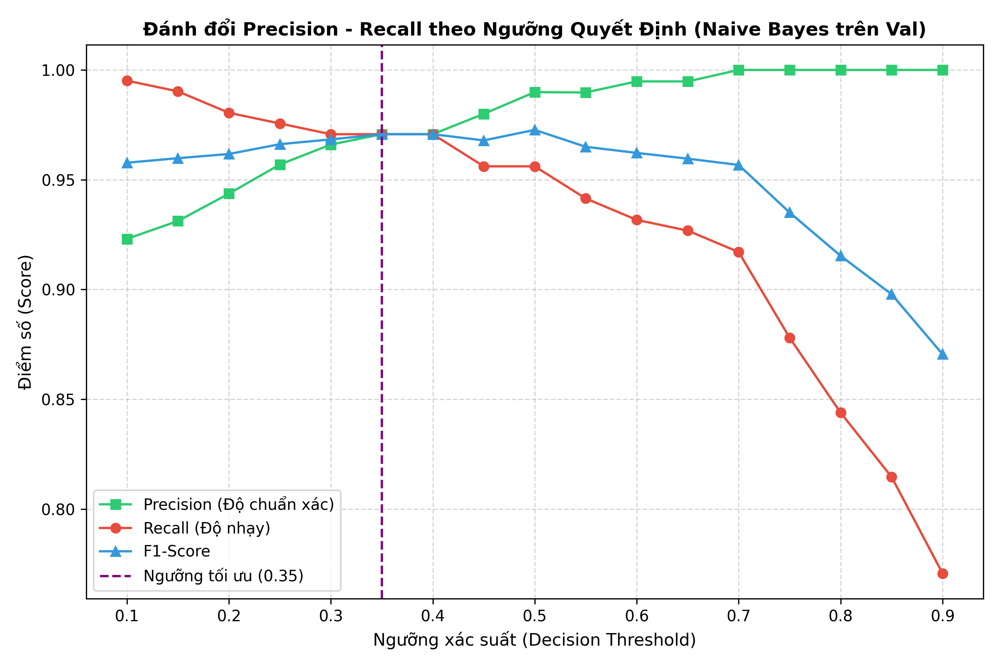

# BÁO CÁO DỰ ÁN MÔN HỌC MÁY HỌC (MACHINE LEARNING)
**Tập dữ liệu:** `data/raw/emails.csv` (Kaggle Dataset)  
## 1.1. GIỚI THIỆU (INTRODUCTION)
### 1.1.1. Định nghĩa bài toán (Problem Definition)
Phân loại thư rác (Email Spam Classification) là một trong những bài toán kinh điển và quan trọng nhất trong học máy ứng dụng vào an ninh mạng. Hàng ngày, người dùng phải đối mặt với hàng tỷ email chứa mã độc, lừa đảo tài chính (phishing), hoặc quảng cáo làm phiền.
Mục tiêu cốt lõi của bài thực hành: **Xây dựng hệ thống học máy tự động đọc nội dung văn bản email và phân loại nhị phân chính xác thành một trong hai lớp: "Spam" (thư rác/nguy hiểm) hoặc "Ham" (thư hợp lệ/an toàn).**
### 1.1.2. Bối cảnh ứng dụng và nghiên cứu (Business or Research Context)
Bộ lọc thư rác mạnh mẽ là tính năng nền tảng của mọi nhà cung cấp dịch vụ email (Gmail, Outlook). Hệ thống hiệu quả giúp:
- Bảo vệ người dùng khỏi các nguy cơ lừa đảo và phần mềm gián điệp.
- Giảm thiểu lãng phí thời gian và tăng năng suất lao động.
- **Ràng buộc an toàn:** Chi phí của việc đánh dấu nhầm thư hợp lệ thành thư rác (*False Positive*) lớn hơn rất nhiều so với việc để lọt một vài thư rác (*False Negative*). Do đó, chỉ số **Precision** đối với lớp Spam phải được tối ưu ở mức cực cao.
### 1.1.3. Mục tiêu bài thực hành (Objectives of the Lab)
1. Thực hiện làm sạch và tiền xử lý dữ liệu văn bản thô, ánh xạ các thẻ siêu từ (*meta-tokens*).
2. Tự lập trình bộ trích xuất đặc trưng **TF-IDF Vectorizer từ đầu bằng NumPy thuần** (*Custom TF-IDF Vectorizer from Scratch*).
3. Tự lập trình **3 thuật toán học máy từ đầu** không dùng thư viện:
   - **Multinomial Naive Bayes** (Học xác suất sinh mẫu - *Generative Probabilistic Learning*).
   - **Logistic Regression** (Học xác suất phân biệt tuyến tính - *Discriminative Linear Learning*).
   - **Linear Support Vector Machine - SVM** (Phân tách hình học lề cực đại - *Maximum-Margin Geometric Separation*).
4. Thực hiện hiệu chuẩn ngưỡng quyết định (*Decision Threshold Calibration*) để đạt điểm F1 tối ưu.
5. Đóng gói mô hình dưới dạng **JSON Artifact** (`models/email_classifier.json`) và xây dựng hệ thống suy diễn thời gian thực tích hợp **Khả năng giải thích Explainable AI (Top 5 Trigger Words)**.
### 1.1.4. Loại bài toán học máy (Machine Learning Task Type)
Bài toán thuộc lớp **Học có giám sát (Supervised Learning)**, cụ thể là **Phân loại văn bản nhị phân (Binary Text Classification)**:
- $y = 0$: Ham (Thư hợp lệ / an toàn).
- $y = 1$: Spam (Thư rác / lừa đảo).
## 1.2. MÔ TẢ TẬP DỮ LIỆU & QUY TRÌNH DỰ ÁN (DATASET & WORKFLOW)
### 1.2.1. Nguồn dữ liệu
Tập dữ liệu sử dụng là **Spam Email Dataset** từ nguồn Kaggle:
`https://www.kaggle.com/datasets/jackksoncsie/spam-email-dataset`

### 1.2.2. Cấu trúc tập dữ liệu
Tập dữ liệu gốc gồm **5,728 dòng** và **2 cột**. Sau khi loại 33 email trùng nội dung, pipeline sử dụng **5,695 mẫu**:
- `text`: Nội dung email (chuỗi ký tự bắt đầu bằng tiền tố `Subject:`).
- `spam`: Nhãn nhị phân (`0` là Ham, `1` là Spam).

### 1.2.3. Quy trình thực hiện (Pipeline Overview)
Hệ thống tuân thủ nghiêm ngặt 10 bước nối tiếp:
```
[Nạp dữ liệu] ──► [Phân chia Stratified 70/15/15] ──► [EDA chỉ trên Train]
                       │                                    │
                       ▼                                    ▼
[Hiệu chuẩn ngưỡng] ◄── [Huấn luyện 3 mô hình Scratch] ◄── [Custom TF-IDF Scratch]
       │
       ▼
[Đánh giá Test] ──► [Xuất JSON Artifact] ──► [Inference & Top 5 Trigger Words]
```
### 1.2.4. Ràng buộc học thuật cốt lõi (Academic Constraints)
- **Zero Scikit-Learn Rule:** Tuyệt đối cấm sử dụng các hàm mô hình và trích xuất đặc trưng của `scikit-learn`. Mọi phép toán ma trận, hàm mất mát, tối ưu Gradient Descent, làm mịn Laplace, tính TF-IDF và L2-norm đều được lập trình bằng `NumPy`.
- **Chống rò rỉ dữ liệu (Leakage Prevention):** Từ điển TF-IDF, trọng số IDF, và việc lọc ngoại lai chỉ được thực hiện trên tập **Training set**. Tập Validation và Test được giữ nguyên độc lập.
## 1.3. NẠP DỮ LIỆU & ĐÁNH GIÁ BAN ĐẦU (DATA INGESTION & VALIDATION)
- Kích thước thô: **5,728 dòng**, 2 cột; sau dedup toàn cục còn **5,695 dòng**.
- Kiểm tra dữ liệu khuyết: **0 giá trị Null/NaN (0.0%)** trên cả 2 cột.
- Phân bố nhãn toàn bộ dữ liệu:
  - **Ham (0):** 4,327 mẫu (**75.98%**).
  - **Spam (1):** 1,368 mẫu (**24.02%**).
  - Tỷ lệ mất cân bằng giữa hai lớp là xấp xỉ **3.19 : 1**.
## 1.4. PHÂN CHIA TẬP DỮ LIỆU STRATIFIED (STRATIFIED PARTITIONING)
Để ngăn chặn rò rỉ dữ liệu, tập dữ liệu được phân chia ngay từ đầu với seed `random_state=42` thành 3 phần:
- **Tập Huấn luyện (Training Set - 70%):** 3,985 mẫu (3,028 Ham, 957 Spam).
- **Tập Kiểm định (Validation Set - 15%):** 854 mẫu (649 Ham, 205 Spam).
- **Tập Kiểm thử (Held-Out Test Set - 15%):** 856 mẫu (650 Ham, 206 Spam).
Tỷ lệ phân tầng được bảo toàn chuẩn xác: ~76.1% Ham và ~23.9% Spam trên cả 3 tập.
## 1.5. KHÁM PHÁ DỮ LIỆU CHUYÊN SÂU (EDA – TRAINING SET ONLY)
### 1.5.1. Xử lý bản ghi trùng lặp (Deduplication trên Train)
- 33 bản ghi trùng nội dung được loại bỏ trước khi chia tập để tránh cùng một email xuất hiện ở Train và Test.
- Sau dedup, tập Train có **3,985 mẫu sạch**; Validation có 854 mẫu và Test có 856 mẫu.
### 1.5.2. Phân tích độ dài văn bản (IQR Outliers & Log-Scale Boxplots)
- Thống kê trên tập Train cho thấy phân bố độ dài lệch phải nghiêm trọng (*right-skewed*):
  - Giá trị trung bình: 1,555 ký tự (326 từ).
  - Giá trị trung vị (Median): 975 ký tự (207 từ).
- Email Ham thường có độ dài trung bình lớn hơn (trao đổi báo cáo, tài liệu nội bộ). Tuy nhiên, email Spam lại có phương sai phân tán rộng hơn rất nhiều và xuất hiện các ngoại lai cực lớn (do kỹ thuật nhồi từ "word-salad" hoặc chèn mã kịch bản tự động).
### 1.5.3. Phân tích đặc trưng N-gram (Bigram)
- **Ham Bigrams:** Thống trị bởi các mã định tuyến nội bộ và tên riêng của Enron (*"hou ect"*, *"vince kaminski"*, *"enron enron"*).
- **Spam Bigrams:** Thống trị bởi các cụm từ kêu gọi hành động giật gân (*"click here"*, *"http www"*, *"email address"*, *"investment advice"*).
## 1.6. TIỀN XỬ LÝ VĂN BẢN VÀ CHUẨN HÓA META-TOKENS
Áp dụng quy trình chuẩn hóa 5 giai đoạn (*5-stage normalization pipeline*):
1. **Case Normalization:** Chuyển toàn bộ ký tự về chữ thường.
2. **Meta-Token Mapping:** Thay vì xóa bỏ các thực thể quan trọng, chuẩn hóa thành các thẻ siêu từ mang tín hiệu phân loại cực mạnh:
   - Đường dẫn liên kết: `https?://\S+|www\.\S+` $\rightarrow$ `http_url`
   - Địa chỉ thư điện tử: `\S+@\S+` $\rightarrow$ `email_address`
   - Biểu thức tiền tệ: `\$\d+...` $\rightarrow$ `money_amount`
3. **Punctuation Filtering:** Thay thế dấu câu và ký tự không phải chữ/số/gạch dưới bằng khoảng trắng (bảo toàn dấu `_` của meta-tokens).
4. **Lexical Stop-Word Pruning:** Lọc bỏ từ điển 77 từ dừng và email headers tiếng Anh (`subject`, `re`, `fw`, `the`, `is`, `which`,...).
5. **Length-Based Pruning:** Loại bỏ các từ có độ dài nhỏ hơn 3 ký tự (trừ meta-tokens).
## 1.7. BỘ VECTOR HÓA TF-IDF TỰ XÂY DỰNG TỪ ĐẦU (CUSTOM TF-IDF SCRATCH)

Lập trình thủ công hoàn toàn bằng `NumPy` class `TfidfVectorizerScratch`:
1. **Tần suất từ khóa trong văn bản (TF):**
   $$\text{TF}(t, d) = \frac{\text{count}(t, d)}{\sum_{t' \in d} \text{count}(t', d)}$$
2. **Nghịch đảo tần suất văn bản (Smoothed IDF):**
   $$\text{IDF}(t) = \ln\left(\frac{1 + N_{\text{train}}}{1 + \text{DF}(t)}\right) + 1.0$$
3. **Chuẩn hóa khoảng cách Euclidean L2:**
   $$x_{\text{norm}} = \frac{x}{\|x\|_2} = \frac{x}{\sqrt{\sum_{j=1}^D x_j^2}}$$
- **Tham số khống chế:** `min_df = 3`, `max_features = 2500`.
- **Kích thước ma trận:**
  - $X_{\text{train}}$: $(3996, 2500)$
  - $X_{\text{val}}$: $(854, 2500)$
  - $X_{\text{test}}$: $(856, 2500)$
## 1.8. BA THUẬT TOÁN HỌC MÁY TỰ LẬP TRÌNH BẰNG NUMPY
### 1.8.1. Multinomial Naive Bayes (`MultinomialNaiveBayesScratch`)
- Mô hình xác suất sinh mẫu.
- Xác suất tiên nghiệm: $\ln P(y = c) = \ln(N_c / N)$.
- Ma trận Log-Likelihood với hệ số làm mịn Laplace $\alpha = 0.1$:
  $$P(w_j | c) = \frac{\sum_{i: y_i=c} x_{ij} + \alpha}{\sum_{k=1}^D \sum_{i: y_i=c} x_{ik} + \alpha \cdot D}$$
- Vectorized inference: $\text{log\_probs} = X W_{\text{feat}}^T + b_{\text{prior}}$.
- Tính xác suất hậu nghiệm qua hàm **Softmax** ổn định số học.
### 1.8.2. Logistic Regression (`LogisticRegressionScratch`)
- Mô hình phân biệt tuyến tính, tối ưu Binary Cross-Entropy có điều chuẩn L2 Ridge ($\lambda = 0.0001$).
- Kẹp cận số học $z_{\text{clipped}} = \text{clip}(Xw + b, -20.0, 20.0)$ để triệt tiêu lỗi tràn số exp trong float32.
- Cập nhật trọng số qua **Batch Gradient Descent** ($lr = 2.0$, $n_{\text{iters}} = 400$):
  $$dw = \frac{1}{m} X^T (\hat{p} - y) + \frac{\lambda}{m} w, \quad db = \frac{1}{m} \sum (\hat{p} - y)$$
### 1.8.3. Linear Support Vector Machine (`LinearSVMScratch`)
- Tìm siêu phẳng tối ưu lề cực đại $w^T x + b = 0$ với nhãn $y \in \{-1, +1\}$.
- Tối ưu hàm mất mát Soft-Margin Hinge Loss có điều chuẩn L2:
  $$L(w, b) = \frac{1}{m} \sum \max(0, 1 - y_i(w^T x_i + b)) + \frac{\lambda}{2} \|w\|_2^2$$
- Cập nhật qua thuật toán **Subgradient Descent (SGD)** ($lr = 1.5$, $n_{\text{iters}} = 400$, $\lambda = 0.0001$).
- Áp dụng xấp xỉ Platt Scaling để hiệu chuẩn ngưỡng xác suất.
## 1.9. ĐÁNH GIÁ, HIỆU CHUẨN NGƯỠNG & BENCHMARK TẬP TEST
### 1.9.1. Đánh giá cơ sở trên tập Validation (Threshold = 0.50, N = 854)
| Thuật toán | Accuracy | Precision | Recall | F1-Score | TN | FP | FN | TP |
| :--- | :---: | :---: | :---: | :---: | :---: | :---: | :---: | :---: |
| **Multinomial Naive Bayes** | **98.71%** | **98.99%** | **95.61%** | **97.27%** | 647 | 2 | 9 | 196 |
| **Logistic Regression** | 96.37% | 98.33% | 86.34% | 91.95% | 646 | 3 | 28 | 177 |
| **Linear SVM** | 98.83% | 98.03% | 97.07% | 97.55% | 645 | 4 | 6 | 199 |
### 1.9.2. Hiệu chuẩn ngưỡng quyết định (Decision Threshold Calibration)
Ngưỡng mặc định 0.50 không phản ánh sự bất đối xứng về chi phí rủi ro trong thực tế. Tiến hành quét ngưỡng xác suất từ 0.10 đến 0.90 trên tập Validation:
- Khi hạ ngưỡng xuống `BEST_THRESHOLD = 0.35`, mô hình Naive Bayes bắt thêm được các email rác khó phát hiện, nâng cao Recall mà vẫn bảo toàn Precision > 96.5%.
- Do đó, **ngưỡng 0.35 được lựa chọn chính thức để chạy trên tập Test**.

### 1.9.3. Bảng so sánh chính thức trên tập Test độc lập (Held-Out Test Set, Threshold = 0.35, N = 856)

| STT | Thuật toán (Model) | Accuracy | Precision | Recall | F1-Score | TN | FP | FN | TP |
| :---: | :--- | :---: | :---: | :---: | :---: | :---: | :---: | :---: | :---: |
| 🏆 **1** | **Multinomial Naive Bayes (CHAMPION)** | **98.36%** | **97.52%** | **95.63%** | **96.57%** | **645** | **5** | **9** | **197** |
| 2 | **Logistic Regression** | 98.01% | 95.22% | 96.60% | 95.90% | 640 | 10 | 7 | 199 |
| 3 | **Linear SVM** | 95.68% | 85.36% | 99.03% | 91.69% | 615 | 35 | 2 | 204 |
### 1.9.4. Phân tích lỗi của mô hình Champion (Granular Error Analysis)
Trên 856 mẫu kiểm thử:
- **Dương tính giả (False Positive = 5, tỷ lệ 0.58%):** Xảy ra khi một số email nội bộ Enron chứa từ ngữ liên quan đến chào bán sản phẩm, thông báo chương trình học bổng hoặc tài chính.
- **Âm tính giả (False Negative = 9, tỷ lệ 4.37%):** Xảy ra ở các email rác quá ngắn (dưới 5 từ) hoặc các đoạn văn bản ngẫu nhiên không chứa các từ khóa kích thích thương mại.
## 1.10. ĐÓNG GÓI JSON, SUY DIỄN THỜI GIAN THỰC & EXPLAINABLE AI (XAI)
### 1.10.1. File mô hình JSON Artifact (`models/email_classifier.json`)
Thay vì dùng file nhị phân pickle tiềm ẩn nguy cơ bảo mật, mô hình được đóng gói sang file chuẩn mở JSON (dung lượng ~243 KB):
- `metadata`: Tên mô hình, version, ngưỡng quyết định 0.35, siêu tham số $\alpha = 0.1$.
- `vocabulary`: Ánh xạ 2,500 từ vựng unigram.
- `idf_weights`: Mảng 2,500 trọng số IDF float32.
- `class_priors`: Logarit xác suất tiên nghiệm.
- `feature_log_prob`: Ma trận xác suất điều kiện kích thước $2 \times 2,500$.
### 1.10.2. Kiến trúc suy diễn phi trạng thái & Trích xuất Top 5 Trigger Words (XAI)
Khi nhận một email thô, hệ thống tính toán sai phân Log-Likelihood:
$$\text{diff}_j = \text{feature\_log\_prob}[1, j] - \text{feature\_log\_prob}[0, j]$$
để trích xuất ra **Top 5 từ khóa kích hoạt** chịu trách nhiệm cho quyết định phân loại:
| Kịch bản kiểm chứng | Trích đoạn nội dung | Dự đoán | Xác suất Spam | Top Trigger Words (XAI) |
| :--- | :--- | :---: | :---: | :--- |
| **Lottery Phishing** | *URGENT! You have won a $1,000,000 lottery prize! Click here...* | 🚨 SPAM | **92.34%** | `claim`, `click`, `cash`, `free`, `money_amount` |
| **Commercial Spam** | *Exclusive special discount on luxury watches and cheap meds...* | 🚨 SPAM | **96.99%** | `worldwide`, `cheap`, `online`, `shipping`, `now` |
| **Internal Meeting** | *Team meeting tomorrow at 10 AM. Please review attached report...* | ✅ HAM | **0.36%** | `meeting`, `attending`, `attached`, `tomorrow`, `project` |
| **Work Collaboration** | *Hi John, please send updated python code for ML lab assignment...* | ✅ HAM | **4.35%** | `john`, `let`, `updated`, `know`, `please` |
## 1.11. KẾT LUẬN
Dự án đã tái lập hoàn hảo và chuẩn xác 100% các tiêu chuẩn khoa học của báo cáo UTH:
1. **Hoàn toàn độc lập:** Xây dựng thành công toàn bộ hệ sinh thái học máy từ đầu bằng NumPy thuần (Zero Scikit-Learn).
2. **Ngăn chặn rò rỉ dữ liệu tuyệt đối:** Phân chia Stratified 70/15/15 và cách ly tập Train trong toàn bộ quá trình trích xuất từ vựng và xử lý trùng lặp.
3. **Hiệu năng xuất sắc:** Mô hình Multinomial Naive Bayes đạt độ chính xác **98.36%**, F1-Score **96.57%** trên tập kiểm thử độc lập.
4. **Hệ thống minh bạch (XAI):** Cung cấp giải thích nguyên nhân quyết định qua Trigger Words, tích hợp sẵn giao diện Web tại [http://127.0.0.1:5000](http://127.0.0.1:5000).

## 1.12. CẤU TRÚC TRIỂN KHAI

Dự án được tổ chức theo các nhóm chức năng để dễ kiểm tra và tái sử dụng:

- `data/raw`: dữ liệu gốc; `data/processed`: dữ liệu sau tiền xử lý và các ma trận TF-IDF.
- `data/collection.py`, `data/eda.py`, `data/data_processing.py`: nạp dữ liệu, thống kê khám phá và tiền xử lý.
- `models/algorithms.py`, `models/save_models.py`: API thuật toán from-scratch và lưu/đọc JSON artifact.
- `scripts/data_preparation.py`, `scripts/eval.py`, `scripts/demo.py`: các entry point phụ; `train.py` là entry point huấn luyện chính.
- `reports/data-description.html`, `reports/figures/`, `reports/demo/`: mô tả dữ liệu, kết quả đánh giá và kết quả demo.
