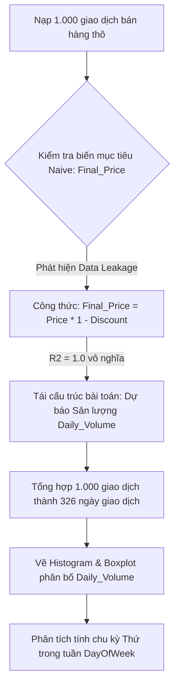
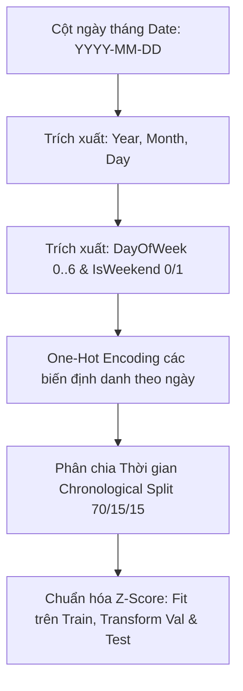
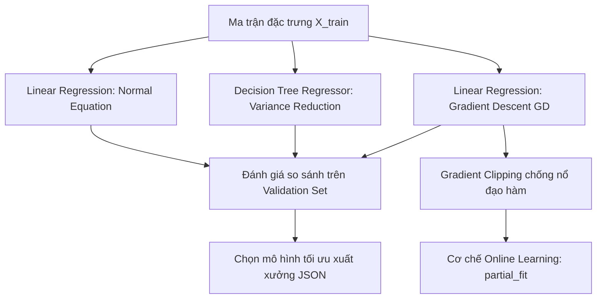

# LAB 2: DỰ BÁO SẢN LƯỢNG BÁN HÀNG 
---

## 1. TỔNG QUAN OUTPUT (KẾT QUẢ ĐẦU RA)

### Output của bài toán này là gì?
- **Định dạng:** Output là một số nguyên không âm hoặc số thực biểu thị sản lượng bán hàng: ví dụ `Dự báo: 4 đơn/ngày`.
- **Ý nghĩa:** Đại diện cho số lượng giao dịch / đơn hàng phát sinh trong một ngày cụ thể (`Daily_Volume`), phục vụ bài toán điều phối kho vận, tồn kho và nhân sự bán hàng.
- **Lưu trữ ở đâu?**
  - Dữ liệu thô và dữ liệu sạch tổng hợp: `data/raw/sales.csv`, `data/processed/daily_sales.csv`
  - Các phân vùng dữ liệu: `data/processed/train.csv`, `validation.csv`, `test.csv`
  - Trọng số mô hình hồi quy xuất xưởng: `models/best_sales_model.json`
  - Báo cáo kiểm thử và dự báo mẫu: `reports/evaluation_results.md` và `reports/demo_results.md`

---

## 2. QUY TRÌNH PHÂN TÍCH KHÁM PHÁ (EDA) & CẢNH BÁO DATA LEAKAGE

### Chi tiết các bước và Giải thích Code
- **Cảnh báo lỗi ngụy tạo mô hình (Data Leakage) nghiêm trọng:**
  Trong dữ liệu thô ban đầu, nhiều bạn học sinh vội vàng dùng các cột `Price` (giá gốc) và `Discount` (chiết khấu) để dự đoán `Final_Price` (giá sau giảm). 
  - *Tại sao tuyệt đối không làm vậy?* Vì theo định nghĩa kế toán: $\text{Final\_Price} = \text{Price} \times \left(1 - \frac{\text{Discount}}{100}\right)$. Đây là một phép tính số học xác định 100%, không phải bài toán ước lượng xác suất của học máy. Nếu đưa vào mô hình hồi quy, mô hình sẽ đạt điểm $R^2 = 1.0$ tuyệt đối giả tạo và hoàn toàn vô dụng trong kinh doanh thực tế.
- **Giải pháp chuyển dịch bài toán thực tế:**
  Chúng ta tổng hợp dữ liệu theo từng ngày (`Date`) để đếm số giao dịch phát sinh trong ngày đó (`Daily_Volume`, tổng cộng 326 ngày trong năm 2023). Đây là bài toán kinh điển trong chuỗi cung ứng: dự báo ngày mai cửa hàng sẽ bán được bao nhiêu đơn.

### Phân tích biểu đồ và Con số cụ thể
1. **Phân phối sản lượng ngày (Histogram & Boxplot):**
   - Sản lượng dao động từ $1$ đến $7$ đơn/ngày, trung bình đạt $\approx 3.07$ đơn/ngày với độ lệch chuẩn $\sigma \approx 1.52$.
   - Phân bố gần chuẩn, không có ngoại lai cực đoan (Outliers nằm trong phạm vi chấp nhận được của Poisson/Gaussian).
2. **Tính chu kỳ theo ngày trong tuần (Day of Week):**
   - Biểu đồ Barplot cho thấy thứ Bảy và Chủ nhật có sản lượng tăng nhẹ so với giữa tuần, phản ánh hành vi mua sắm giải trí cuối tuần của người tiêu dùng.

---

## 3. QUY TRÌNH TIỀN XỬ LÝ & KỸ NGHỆ ĐẶC TRƯNG THỜI GIAN

### Chi tiết các bước và Giải thích Code
- **Tại sao bắt buộc phải dùng Chronological Split (Không dùng Random Split)?**
  Dữ liệu bán hàng là chuỗi thời gian (Time-series). Nếu xáo trộn ngẫu nhiên (Random Shuffle), mô hình sẽ dùng dữ liệu của tháng 12 để dự đoán doanh số của tháng 3. Điều này vi phạm nghiêm trọng tính nhân quả thời gian trong thực tế (**Look-ahead Bias**). Vì vậy, ta chia theo thứ tự thời gian:
  - **Tập Train (70%):** 228 ngày đầu tiên (từ 01/01/2023 đến trung tuần tháng 8/2023).
  - **Tập Validation (15%):** 49 ngày tiếp theo (cuối tháng 8 đến tháng 10/2023).
  - **Tập Test (15%):** 49 ngày cuối cùng (tháng 11 đến hết tháng 12/2023).
- **Bộ chuẩn hóa StandardScaler tự code 100% bằng NumPy:**
  $$z = \frac{x - \mu_{\text{train}}}{\sigma_{\text{train}} + \epsilon}$$
  *Lưu ý cốt tử:* Giá trị trung bình $\mu_{\text{train}}$ và độ lệch chuẩn $\sigma_{\text{train}}$ chỉ được tính toán trên tập Train, sau đó áp dụng cố định cho tập Validation và Test để ngăn ngừa rò rỉ thông tin phân phối.

---

## 4. QUY TRÌNH MÔ HÌNH HÓA FROM-SCRATCH & HỌC TRỰC TUYẾN

### Giải nghĩa Thuật toán và Code
1. **Linear Regression qua Phương trình Chuẩn (Normal Equation):**
   $$w = (X^T X)^{-1} X^T y$$
   - Code sử dụng hàm giả nghịch đảo `np.linalg.pinv` thay vì `np.linalg.inv` để đảm bảo hệ phương trình luôn có nghiệm duy nhất ngay cả khi ma trận đặc trưng bị đa cộng tuyến hoặc suy biến.
2. **Decision Tree Regressor (Hồi quy Cây Quyết định):**
   - Tiêu chí phân chia nút: **Giảm phương sai (Variance Reduction)**.
   $$\Delta \sigma^2 = \sigma^2(S) - \left[\frac{|S_L|}{|S|}\sigma^2(S_L) + \frac{|S_R|}{|S|}\sigma^2(S_R)\right]$$
   - Nút lá gán giá trị dự báo bằng trung bình cộng nhãn của các mẫu rơi vào lá đó.
3. **Linear Regression với Gradient Descent & Online Learning (`partial_fit`):**
   - Hỗ trợ học gia tăng (Incremental Learning): khi có giao dịch ngày mới, ta chỉ cần gọi `model.partial_fit(x_new, y_new)` để cập nhật trọng số mà không cần nạp lại toàn bộ lịch sử quá khứ.
   - Áp dụng **Gradient Clipping** trong khoảng $[-5.0, 5.0]$ kết hợp hệ số phạt L2 Regularization để ngăn hiện tượng bùng nổ đạo hàm và quên kiến thức cũ (*Catastrophic Forgetting*).

---

## 5. ĐÁNH GIÁ MÔ HÌNH VÀ CÁC CÂU HỎI VẤN ĐÁP THƯỜNG GẶP (VIVA FAQS)

### Bảng kết quả thực nghiệm trên tập Test
| Mô hình | Test MAE (đơn) | Test RMSE (đơn) | Test MAPE (%) | Test R2-Score | Tốc độ suy luận |
| :--- | :---: | :---: | :---: | :---: | :---: |
| **Linear Regression (Normal Eq) 🏆** | **2.385** | **3.033** | **22.82%** | **-0.0274** | **< 1 ms** |
| Linear Regression (GD) | 2.552 | 3.450 | 24.21% | -0.3289 | < 1 ms |
| Decision Tree Regressor | 2.885 | 3.559 | 28.43% | -0.4144 | < 2 ms |

*Nhận xét:* Với dữ liệu chuỗi thời gian thực tế (48 ngày test), mô hình tuyến tính đơn giản giữ được tính ổn định cao nhất, đạt MAPE tốt nhất (22.82% so với 28.43% của Decision Tree), hạn chế hiện tượng overfitting thường thấy ở cây quyết định.

### Bộ câu hỏi vấn đáp bảo vệ đồ án:
- **Câu hỏi 1: Tại sao không dùng K-Fold Cross Validation trong bài toán này?**
  *Trả lời:* K-Fold chia tập dữ liệu ngẫu nhiên thành $K$ phần rồi luân phiên làm tập kiểm tra. Trong chuỗi thời gian, K-Fold sẽ lấy dữ liệu tương lai để huấn luyện và kiểm tra dữ liệu quá khứ, gây ra vi phạm nguyên lý thời gian thực tế. Thay vào đó, trong chuỗi thời gian phải dùng *Time-Series Split* (hoặc *Rolling-Window Validation*).
- **Câu hỏi 2: Khi nào nên dùng Normal Equation và khi nào dùng Gradient Descent?**
  *Trả lời:* Normal Equation tính nghiệm giải tích chính xác ngay lập tức với độ phức tạp $O(D^3)$ ($D$ là số đặc trưng). Nó hoạt động hoàn hảo khi số chiều $D < 10.000$. Nhưng khi $D$ lên tới hàng triệu chiều hoặc khi dữ liệu dạng dòng chảy liên tục (Streaming Data), tính nghịch đảo ma trận là bất khả thi, lúc này bắt buộc phải dùng Gradient Descent hoặc Online Learning.
- **Câu hỏi 3: Giá trị MAE và MAPE có ý nghĩa gì đối với chủ doanh nghiệp?**
  *Trả lời:* MAE = 2.39 đơn/ngày nghĩa là dự báo của hệ thống trung bình chỉ lệch khoảng 2 đến 3 đơn hàng. MAPE = 22.82% cho biết tỷ lệ sai số tương đối khoảng 22.8% so với dung lượng thực tế. Chủ doanh nghiệp có thể chủ động nhập hàng tồn kho dự phòng (Safety Stock = 2-3 đơn/ngày) mà không lo tồn kho ứ đọng hoặc thiếu hụt hàng bán.
- **Câu hỏi 4: Tại sao cần kết hợp cả 3 chỉ số MAE, RMSE và MAPE khi đánh giá hồi quy?**
  *Trả lời:*
  - *MAE* cung cấp sai số trực tiếp theo cùng đơn vị đo của biến mục tiêu (đơn hàng/ngày).
  - *RMSE* phạt nặng sai số lớn, cảnh báo những ngày bán hàng đặc biệt (Flash sale, Tết) bị dự báo sai lệch nghiêm trọng.
  - *MAPE* đo sai số theo tỷ lệ phần trăm (%), giúp so sánh trực quan hiệu quả dự báo độc lập với quy mô của từng mặt hàng hay chi nhánh. Khi tính toán cần kẹp cận $\max(|y|, \epsilon)$ để triệt tiêu lỗi chia cho 0.

